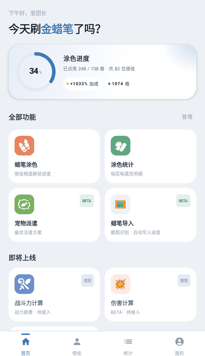
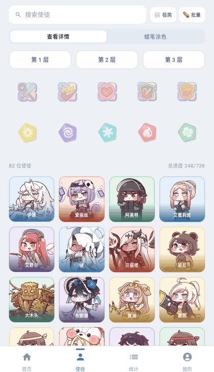
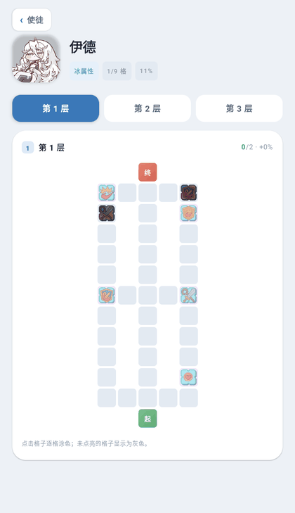
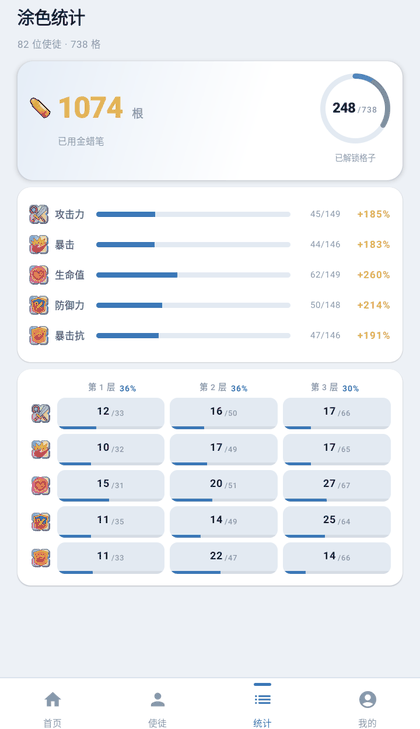
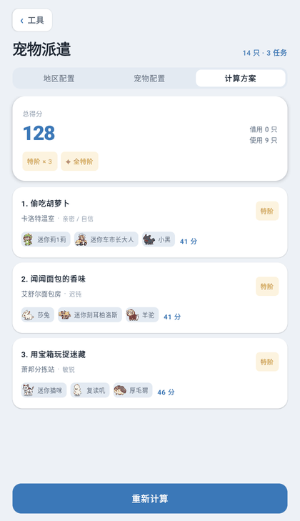
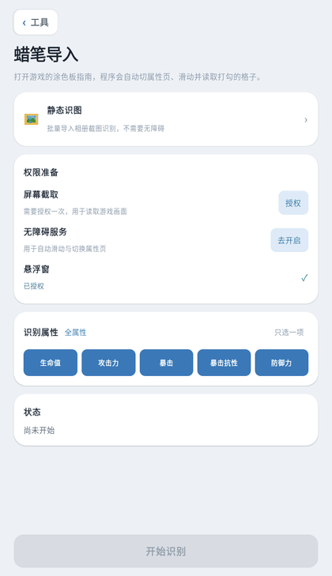
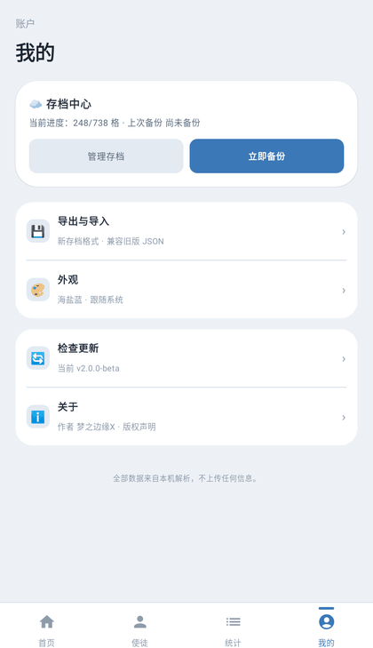

# 圣团长日记 · Trickcal Master

《嘟嘟脸恶作剧》（Trickcal）的第三方离线进度管理工具。用 Kotlin + Jetpack Compose 写的 Android App，记录 82 位使徒三层涂色板的点亮情况，并顺带算战斗力、排宠物派遣。

**全程离线**：数据全部内置在 `assets/`，不联网、不上传、不要账号。

<p align="center">
  
  
  
  
</p>
<p align="center">
  
  
  
</p>

## 目录

- [这是什么](#这是什么)
- [功能](#功能)
- [数据规模](#数据规模)
- [构建](#构建)
- [工程结构](#工程结构)
- [数据结构与关键规则](#数据结构与关键规则)
- [设计稿](#设计稿)
- [已知差异与限制](#已知差异与限制)
- [版权与免责](#版权与免责)
- [许可](#许可)

## 这是什么

游戏里的涂色板要给每张角色卡的三个格子逐格涂蜡笔，一层 13 行 × 7 列，靠肉眼记「哪个角色哪一层还差几格」非常难受。这个 App 把棋盘数字化，点一下就知道进度，再也不用翻游戏。

它同时解决三个具体问题：

1. **进度记录**——82 位使徒 × 3 层 × 738 个可涂目标格，点格子即记录，进度落本地存档。
2. **涂色规划**——按「层 × 属性 × 性格」筛选，标出哪张卡还差什么属性，灰掉的头像代表这组已涂完。
3. **结果计算**——战斗力公式还原、宠物派遣最优解，都是把游戏里的算术搬到手机上算。

## 功能

| 模块 | 说明 |
|---|---|
| 首页 | 总体进度环、四宫格功能入口、自动快照提示 |
| 使徒 | 82 位使徒卡片列表，两列布局；支持「查看详情 / 蜡笔涂色」双模式切换、紧凑网格模式 |
| 详情 | 单角色三层棋盘，点格涂色；层 × 属性切换；快捷涂色 |
| 统计 | 全局进度、按属性、按层、层 × 属性矩阵、下一步建议 |
| 战斗力计算 | 依据 86 位角色系数还原游戏战力公式 |
| 宠物派遣 | 44 只宠物 / 6 区域 / 30 任务，枚举任务组合求最优派遣 |
| 蜡笔导入（识图） | 读取涂色板截图，用中文 OCR + OpenCV 自动识别每张卡的勾选状态 |
| 静态识图 | 纯本地图片识别，不走截屏与无障碍，适合导入相册里的截图 |
| 存档中心 | 进度导出 / 导入 JSON、自动快照回滚 |
| 我的 | 主题切换、数据来源、关于与版权声明 |

**主题**：4 套皮肤（暖橙 / 薄荷绿 / 海盐蓝 / 暮光紫）× 深浅色（跟随系统 / 浅色 / 深色），共 8 套配色。

## 数据规模

| 数据 | 数量 |
|---|---|
| 使徒 | 82 位 |
| 可涂目标格 | 738 个（每人 9 个：3 层 × 3 属性） |
| 棋盘 | 每人 3 层，每层 13 行 × 7 列 |
| 属性 | 5 种：攻击力 / 暴击 / 生命值 / 防御力 / 暴击抗性 |
| 性格 | 5 种：光 / 暗 / 冰 / 火 / 草 |
| 宠物 | 44 只 |
| 派遣区域 / 任务 | 6 个区域 / 30 个任务 |
| 战力系数 | 86 位角色 |

## 构建

环境要求：

- JDK 17 或更高（`compileOptions` 与 `jvmTarget` 均为 17）
- Android SDK Platform 36
- Gradle 8.13（仓库自带 wrapper，无需本机安装）

`local.properties` 与 `gradle.properties` 都在 `.gitignore` 里，克隆后需要自己补：

```properties
# local.properties —— 指向本机 Android SDK
sdk.dir=/path/to/Android/Sdk
```

```properties
# gradle.properties —— 项目必需的开关项
org.gradle.jvmargs=-Xmx3072m -Dfile.encoding=UTF-8
android.useAndroidX=true
android.nonTransitiveRClass=true
kotlin.code.style=official
```

> 本机 JDK 与默认 `JAVA_HOME` 不一致时，可自行在上述文件里加 `org.gradle.java.home=<JDK 路径>`。

编译 APK：

```bash
./gradlew :app:assembleDebug
```

产物：`app/build/outputs/apk/debug/app-debug.apk`

单元测试（纯 JVM，不需要设备）：

```bash
./gradlew :app:testDebugUnitTest
```

构建参数：

| 项 | 值 |
|---|---|
| applicationId | `com.trickcal.crayon.master` |
| versionName | `2.0.0-beta`（versionCode 201） |
| minSdk / targetSdk / compileSdk | 26 / 36 / 36 |
| AGP / Kotlin / Gradle | 8.12.3 / 2.0.21 / 8.13 |
| ABI | `arm64-v8a`、`x86_64` |

## 工程结构

```
.
├── app/src/main/
│   ├── assets/
│   │   ├── data/          # characters / petdispatch / battlepower / demo_progress
│   │   ├── avatars/ pets/ cells/ pers/ glyph/ glyphs/ ui/   # webp 图片资源
│   ├── java/com/trickcal/crayon/master/
│   │   ├── MainActivity.kt
│   │   ├── capture/       # 截图识别：BoardScanner / NameMatcher / StaticScanner / 无障碍服务
│   │   ├── data/          # Models / GameData / SaveStore
│   │   ├── domain/        # BoardEngine / BattlePowerEngine / PetDispatchSolver
│   │   └── ui/            # AppRoot / AppViewModel / theme / components / screens（10 页）
│   └── res/
├── app/src/test/          # DomainTest（棋盘、战力、派遣的纯 JVM 测试）
├── demo/                  # HTML 原型：视觉与交互的唯一规格来源
├── docs/screenshots/      # README 用截图
└── 涂色板识别算法-技术需求.md   # 识图算法的完整规格书
```

## 数据结构与关键规则

**格子 ID**：`角色_层_属性_行-列`，例如 `ed_1_attack_2-3`。不依赖出现序号，游戏更新加角色也不会让旧存档漂移。

**棋盘符号**（`characters.json` 里每层 13 行字符串，每行 7 字符）：

| 符号 | 含义 |
|---|---|
| `.` | 棋盘外空白 |
| `W` | 棋盘内的普通格，无属性 |
| 大写属性字母 | 可涂目标格，计入 738 |
| 小写属性字母 | 性格固定格，不计入目标 |
| `E` / `S` | 层内特殊定位标记 |

**层加成**：第 1/2/3 层单格加成分别为 +3 / +4 / +5，金蜡笔消耗 2 / 4 / 6。

**筛选**：层与属性是「同层交集」——候选层中必须存在某一层同时包含全部选中属性，而不是分别匹配。

**快捷涂色**：只在「单层 + 单属性」时成立，整组一起涂亮；已有涂色时再点整组取消。

**宠物派遣**：任务键用 `区域#任务id`。旧版用 `任务id` 做键，6 个区域的任务 id 都是 0–4，改一个区域会串到其它区域，这里按区域隔离。

## 设计稿

`demo/` 是可点击的 HTML 原型，也是**视觉与交互的唯一规格来源**。App 里每一个尺寸、圆角、间距、字号、描边、透明度都从 `demo/style.css` 逐项移植，不做「看着更好」的再设计。

原型本地打开需要 HTTP 服务（`file://` 会因 CORS 加载不到数据）：

```bash
cd demo
python -m http.server 8791
# http://127.0.0.1:8791/index.html
```

## 已知差异与限制

- `battlepower.json` 的系数在源数据里是字符串，原型的 JS 直接相加会退化成字符串拼接导致 `NaN`；App 侧统一按数值解析。
- 截图识图分辨率敏感：只接受游戏渲染尺寸（按高度缩放到 720）的截图，带模拟器边框或控制栏的图坐标会失效。算法细节见 [`涂色板识别算法-技术需求.md`](涂色板识别算法-技术需求.md)。
- 目前只出 debug 构建（调试签名）。正式分发需在 `app/build.gradle.kts` 补 `signingConfigs` 与 release keystore。
- 原型里的装饰性元素（手机外壳、左侧导航、`#/xxx` 深链）不进入 App。

## 版权与免责

本工具为个人制作的第三方非官方工具，与游戏官方无任何关联。

《嘟嘟脸恶作剧》的游戏名称、角色形象、美术素材等内容的版权均归官方所有。本仓库仅将游戏内数据整理为结构化 JSON 供计算与记录使用，不含任何修改游戏、破解或联网功能。若官方有异议，可联系删除。

数据与算法均为社区向整理，按现状提供，不保证与游戏版本同步。

## 许可

代码以 [MIT License](LICENSE) 发布。游戏素材版权不适用本许可，归官方所有。
